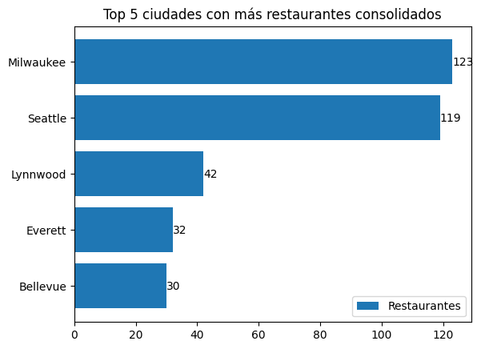
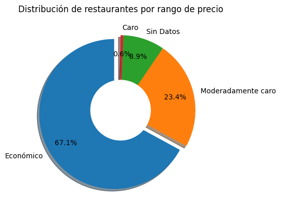
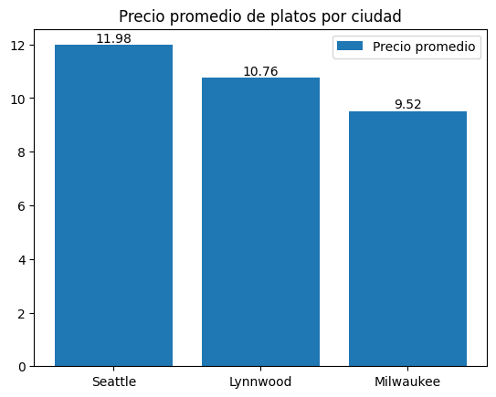
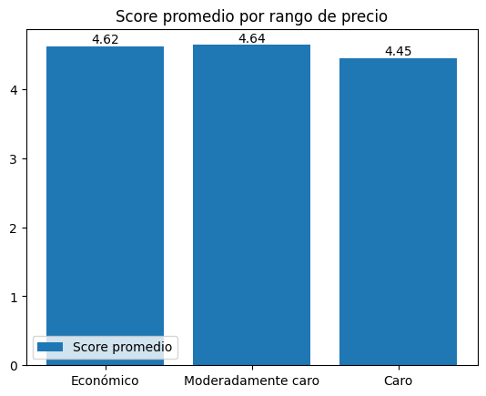

# 🍔 Pipeline ETL & Inteligencia de Mercado (Food Delivery)

Trabajo Práctico Integrador · Módulo **Python para Análisis de Datos (ETL)**

**Autor:** Diego Andrés Gamero Cotrina

Un CEO de una startup de Food Delivery quiere expandirse en Estados Unidos. Antes de decidir en qué ciudades invertir, necesita saber dónde están sus competidores, cómo se comportan los precios y si un restaurante caro ofrece mejor calidad. Este proyecto construye un pipeline ETL que limpia los datos crudos de Web Scraping, los carga en una base SQLite y responde esas preguntas con SQL y gráficos.

---

## 📑 Índice

1. [🛠️ Tecnologías utilizadas](#tecnologias)
2. [📦 Datos de entrada](#datos)
3. [📥 Fase 1: EXTRACT](#extract)
   - [🔍 Data profiling](#profiling)
4. [🧹 Fase 2: TRANSFORM](#transform)
   - [🏷️ Mapeo de precios](#mapeo)
   - [📍 Split de la dirección](#split)
   - [✅ Filtro de calidad](#calidad)
   - [💲 Casteo de precios del menú](#casteo)
5. [💾 Fase 3: LOAD](#load)
   - [⚙️ Optimización y cruce](#cruce)
   - [🗄️ Carga a SQLite](#carga)
6. [📊 Fase 4: BI – Reporte al CEO](#bi)
   - [1️⃣ Penetración geográfica](#q1)
   - [2️⃣ Oportunidad de precio](#q2)
   - [3️⃣ Estrategia de menú por ciudad](#q3)
   - [4️⃣ Precio vs calidad](#q4)
7. [🏁 Conclusiones finales](#conclusiones)

---

<a id="tecnologias"></a>
## 🛠️ Tecnologías utilizadas


| Tecnología | Uso en el proyecto |
|---|---|
| 🐍 **Python 3** | Lenguaje base del pipeline |
| 🐼 **pandas** | Lectura de CSV, limpieza, transformación y merge |
| 📂 **pathlib** | Recorrer la carpeta de archivos de menús |
| 🗄️ **SQLite / sqlite3** | Base de datos local `delivery_insights.db` y consultas SQL |
| 📊 **matplotlib** | Gráficos del reporte al CEO |
| 🧱 **Databricks** | Entorno de ejecución del notebook |
| 🐙 **Git / GitHub** | Control de versiones y entrega del proyecto |

---

<a id="datos"></a>
## 📦 Datos de entrada

| Archivo | Descripción | Dimensiones |
|---|---|---|
| `restaurants.csv` | Catálogo de restaurantes: dirección completa, puntaje, calificaciones y rango de precio en símbolos (`$`, `$$`, …) | 63,469 × 11 |
| `restaurant_menus_parte_1..10.csv` | Platos de cada restaurante, con su precio en texto (ej. `"15.99 USD"`) | 836,350 × 5 (10 archivos) |

---

## 📦 Importación de librerías

Se importan pandas para el manejo de datos, sqlite3 para la base de datos, matplotlib para los gráficos y pathlib para recorrer la carpeta de archivos.

```python
import pandas as pd
import sqlite3 
import matplotlib.pyplot as plt
from pathlib import Path
```

---

<a id="extract"></a>
# 📥 FASE 1: EXTRACT

En esta fase se leen los archivos crudos y se revisa su estado antes de limpiarlos.

Primero se define la ruta de la carpeta que contiene las 10 partes del menú:

```python
DATOS = Path('/Workspace/Users/diegoagameroc@gmail.com/Primerospasos/Project_Python/Data/menus_restaurantes')
```

Se recorre la carpeta y se lee cada CSV. Cada DataFrame se guarda en una lista, y se agrega la columna `Origen` con el nombre del archivo para saber de qué parte viene cada fila. Los archivos que no son CSV se ignoran.

```python
Archivos = DATOS.glob('*')
lista_df =[]
for archivo in Archivos:
    if archivo.suffix == '.csv':
        print(archivo)
        df=pd.read_csv(archivo,sep=',')
        lista_df.append(df)
        df['Origen']=archivo.stem
    else:
        print('No es CSV')
```

Se unen las 10 partes en un solo DataFrame con `pd.concat` (`ignore_index=True` reinicia el índice) y se lee el catálogo de restaurantes:

```python
df_menus = pd.concat(lista_df, ignore_index= True)
df_restaurantes = pd.read_csv('/Workspace/Users/diegoagameroc@gmail.com/Primerospasos/Project_Python/Data/restaurants.csv')
```

<a id="profiling"></a>
### 🔍 Data profiling

Se revisa cuántos archivos se leyeron y las dimensiones de cada DataFrame:

```python
#Profiling
print(len(lista_df))        
print(df_menus.shape)       
print(df_restaurantes.shape) 
```

📌 **Resultado:**

```text
10
(836350, 6)
(63469, 11)
```

Se leyeron los 10 archivos. `df_menus` tiene 6 columnas porque incluye `Origen`.

Tipos de datos y nulos de `df_menus`:

```python
# df_menus
print(df_menus.shape)
print(df_menus.dtypes)
print(df_menus.isnull().sum())
```

📌 **Resultado:**

```text
(836350, 6)

restaurant_id     int64        restaurant_id         0
category         object        category              0
name             object        name                  1
description      object        description      200324
price            object        price                 0
Origen           object        Origen                0
```

Tipos de datos y nulos de `df_restaurantes`:

```python
# df_restaurantes
print(df_restaurantes.shape)
print(df_restaurantes.dtypes)
print(df_restaurantes.isnull().sum())
```

📌 **Resultado:**

```text
(63469, 11)

id               int64         id                  0
position         int64         position            0
name            object         name                0
score          float64         score           28167
ratings        float64         ratings         28167
category        object         category           85
price_range     object         price_range     10617
full_address    object         full_address      453
zip_code        object         zip_code          517
lat            float64         lat                 0
lng            float64         lng                 0
```

**🧠 Hallazgos del diagnóstico:**

- `price` en el menú es texto (`object`), no número. Hay que castearlo antes de calcular promedios.
- `price_range` usa símbolos (`$`, `$$`, …) y tiene 10,617 nulos.
- `score` y `ratings` tienen 28,167 nulos cada uno: son restaurantes sin reseñas.
- `full_address` concentra calle, ciudad, estado y ZIP en un solo texto, con 453 nulos.
- `description` tiene 200,324 nulos, pero no se usa en el análisis.

---

<a id="transform"></a>
# 🧹 FASE 2: TRANSFORM

Limpieza de `df_restaurantes` (mapeo de precios, split de direcciones y filtro de calidad) y de `df_menus` (casteo de precios a float y eliminación de precios inválidos).

<a id="mapeo"></a>
### 🏷️ En `df_restaurantes`: mapeo de precios

Antes de mapear, se revisan los valores que existen en `price_range`, incluyendo nulos:

```python
print(df_restaurantes['price_range'].value_counts(dropna=False))
```

📌 **Resultado:**

```text
$                    37637
$$                   14952
NaN                  10617
$$$                    237
$$$$                    25
$$$$$$$$$$$$$$$$$        1
```

Aparece un valor atípico (`$$$$$$$$$$$$$$$$$`) que no corresponde a ninguna categoría.

Se define un diccionario que traduce cada símbolo a una categoría legible:

```python
mapa_precios = {
    '$': 'Económico',
    '$$': 'Moderadamente caro',
    '$$$': 'Caro',
    '$$$$': 'Muy caro',
}
```

Se aplica el diccionario con `.map()`. Los valores que no están en el diccionario quedan como `NaN`:

```python
df_restaurantes['rango_precio'] = df_restaurantes['price_range'].map(mapa_precios)

# Después del mapeo
print(df_restaurantes['rango_precio'].value_counts(dropna=False))
```

📌 **Resultado:**

```text
Económico             37637
Moderadamente caro    14952
NaN                   10618
Caro                    237
Muy caro                 25
```

Los nulos pasan de 10,617 a 10,618 porque el valor atípico también queda como `NaN`, que es el comportamiento esperado.

<a id="split"></a>
### 📍 En `df_restaurantes`: split de la dirección

Se separa `full_address` por comas. La calle es la primera parte, la ciudad es la tercera desde el final, y el estado y ZIP son las dos últimas. Contar desde el final evita errores cuando la dirección incluye apartamento o suite. `.str.strip()` quita los espacios que quedan después de cada coma.

```python
partes = df_restaurantes['full_address'].str.split(',')

df_restaurantes['calle'] = partes.str[0].str.strip()

df_restaurantes['ciudad'] = partes.str[-3].str.strip()

df_restaurantes['estado_zip'] = (
    partes.str[-2].str.strip() + ' ' + partes.str[-1].str.strip()
)

display(print(df_restaurantes[['full_address', 'calle', 'ciudad', 'estado_zip']].head()))
```

📌 **Resultado:**

| full_address | calle | ciudad | estado_zip |
|---|---|---|---|
| 224 Daniel Payne Drive, Birmingham, AL, 35207 | 224 Daniel Payne Drive | Birmingham | AL 35207 |
| 1521 Pinson Valley Parkway, Birmingham, AL, 35217 | 1521 Pinson Valley Parkway | Birmingham | AL 35217 |
| 541-B Graymont Ave, Birmingham, AL, 35204 | 541-B Graymont Ave | Birmingham | AL 35204 |
| 1580 Montgomery Highway, Hoover, AL, 35226 | 1580 Montgomery Highway | Hoover | AL 35226 |
| 314 17th St N, Birmingham, AL, 35203 | 314 17th St N | Birmingham | AL 35203 |

<a id="calidad"></a>
### ✅ En `df_restaurantes`: filtro de calidad

Se eliminan los restaurantes sin puntaje o con puntaje 0, y `category` se pasa a minúsculas para que valores como `"Pizza"` y `"pizza"` cuenten igual. 

```python
df_restaurantes = df_restaurantes[
    df_restaurantes['score'].notna() & (df_restaurantes['score'] != 0)
].copy()

df_restaurantes['category'] = df_restaurantes['category'].str.lower()

print(df_restaurantes.shape)
print(df_restaurantes['score'].isna().sum()) 
print(df_restaurantes['category'].head())
```

📌 **Resultado:**

```text
(35302, 15)
0
4             breakfast and brunch, burgers, sandwiches
6                                sushi, asian, japanese
13    breakfast and brunch, salad, sandwich, family ...
15    ice cream &amp; frozen yogurt, comfort food, d...
18    middle eastern, mediterranean, vegetarian, gre...
```

Quedan 35,302 restaurantes con puntaje válido (se eliminaron 28,167) y 15 columnas, porque se agregaron `rango_precio`, `calle`, `ciudad` y `estado_zip`.

<a id="casteo"></a>
### 💲 En `df_menus`: casteo de precios

Se guarda el número de filas antes de limpiar para medir cuántas se eliminan. Luego se quita el texto `" USD"`, se reemplaza la coma decimal por punto y se convierte a `float`.

```python
filas_antes = len(df_menus)
df_menus['price'] = (
    df_menus['price']
    .str.replace(' USD', '', regex=False)
    .str.replace(',', '.', regex=False)
    .astype(float)
)
```

Se eliminan los platos con precio nulo, igual a 0 o negativo, porque no representan una venta real:

```python
# 2. Eliminar precios nulos, 0.0 y negativos
df_menus = df_menus[
    df_menus['price'].notna() & (df_menus['price'] > 0)
].copy()

print(f"Filas eliminadas: {filas_antes - len(df_menus):,}")
print(df_menus['price'].dtype)    
print(df_menus['price'].describe())
```

📌 **Resultado:**

```text
Filas eliminadas: 37,553
float64

count    798797.00
mean         10.36
std          11.60
min           0.01
25%           4.39
50%           8.38
75%          13.19
max        1099.99
```

`price` ya es numérico (`float64`). Quedan 798,797 platos con un precio promedio de 10.36 USD. El máximo de 1,099.99 USD es un valor atípico, probablemente un error del scraping.

---

<a id="load"></a>
# 💾 FASE 3: LOAD

Reducción del dataset, cruce entre restaurantes y menús, y carga a SQLite.

<a id="cruce"></a>
### ⚙️ Optimización y cruce

Para no saturar la memoria, el CEO solo quiere analizar restaurantes consolidados: los que tienen más de 100 calificaciones. Después se hace un `INNER JOIN` con los menús, de modo que solo quedan los platos de esos restaurantes. `suffixes` diferencia las columnas que se repiten en ambas tablas (`name` y `category`).

```python
df_restaurantes_consolidados = df_restaurantes[df_restaurantes['ratings'] > 100].copy()
print(f"Restaurantes consolidados: {len(df_restaurantes_consolidados):,}")

df_master = pd.merge(
    df_restaurantes_consolidados,
    df_menus,
    left_on='id',               # en df_restaurantes
    right_on='restaurant_id',   # en df_menus
    how='inner',
    suffixes=('_rest', '_menu') 
)
print(df_master.shape)
print(df_master.columns.tolist())
```

📌 **Resultado:**

```text
Restaurantes consolidados: 8,702
(63221, 21)
['id', 'position', 'name_rest', 'score', 'ratings', 'category_rest', 'price_range',
 'full_address', 'zip_code', 'lat', 'lng', 'rango_precio', 'calle', 'ciudad',
 'estado_zip', 'restaurant_id', 'category_menu', 'name_menu', 'description',
 'price', 'Origen']
```

De los 8,702 restaurantes consolidados, solo 671 tienen platos en los archivos de menú. Por eso `df_master` queda con 63,221 filas, una por cada plato.

**🔻 Embudo del pipeline:**

| Etapa | Restaurantes | Platos |
|---|---|---|
| Datos crudos | 63,469 | 836,350 |
| Después de limpieza (score / precio) | 35,302 | 798,797 |
| Restaurantes consolidados (ratings > 100) | 8,702 | — |
| `df_master` (INNER JOIN) | 671 | 63,221 |

<a id="carga"></a>
### 🗄️ Carga a la base de datos

Se crea (o abre) la base SQLite local `delivery_insights.db`:

```python
con = sqlite3.connect("delivery_insights.db")
```

Se guarda una copia de respaldo en CSV:

```python
df_master.to_csv('master.csv', sep=',', index=False)
```

Se carga `df_master` como tabla `master_food_data`. `if_exists='replace'` reemplaza la tabla si ya existe, y `index=False` evita guardar el índice de pandas como columna:

```python
df_master.to_sql('master_food_data', con, if_exists='replace', index=False)
```

Se verifica la carga leyendo las primeras filas desde SQLite:

```python
pd.read_sql('SELECT * FROM master_food_data', con).head()
```

📌 **Resultado:** la tabla `master_food_data` queda cargada con **63,221 filas y 21 columnas**.

| id | name_rest | score | rango_precio | ciudad | name_menu | price |
|---|---|---|---|---|---|---|
| 1739 | Pho Cali Noodle House | 4.4 | Económico | Milwaukee | Spring Roll | 6.99 |

---

<a id="bi"></a>
# 📊 FASE 4: BI – Reporte al CEO

Cada pregunta se responde con una consulta SQL sobre `master_food_data` mediante `pd.read_sql`, seguida de un gráfico y una conclusión para el CEO.

Como la tabla tiene una fila por plato, los conteos de restaurantes usan `COUNT(DISTINCT id)` para no contar el mismo restaurante varias veces.

<a id="q1"></a>
### 1️⃣ Penetración geográfica: top 5 ciudades

**Pregunta:** ¿Cuáles son las 5 ciudades con más restaurantes consolidados?

```python
#Penetración Geográfica: ¿Cuáles son las 5 ciudades (ciudad) con la mayor
#cantidad de restaurantes consolidados (los que quedaron en nuestra base)?
#Gráfico sugerido: Gráfico de barras horizontal ordenado de mayor a menor.
```

```python
query_ciudades = """
SELECT 
ciudad 
,COUNT(DISTINCT id) AS total_restaurantes
FROM master_food_data
WHERE ciudad IS NOT NULL
GROUP BY ciudad
ORDER BY total_restaurantes DESC
LIMIT 5
"""
df_top5_ciudades= pd.read_sql(query_ciudades,con)
```

📌 **Resultado:**

| ciudad | total_restaurantes |
|---|---|
| Milwaukee | 123 |
| Seattle | 119 |
| Lynnwood | 42 |
| Everett | 32 |
| Bellevue | 30 |

```python
df_top5_ciudades = pd.read_sql(query_ciudades, con)
df_plot = df_top5_ciudades.sort_values('total_restaurantes')

plt.barh(df_plot.ciudad, df_plot.total_restaurantes, label='Restaurantes')
plt.title("Top 5 ciudades con más restaurantes consolidados")
plt.legend()
plt.bar_label(plt.gca().containers[0])
plt.show()
```



**🔎 Análisis**

- Milwaukee (123) y Seattle (119) lideran. Juntas suman 242 de 671 restaurantes consolidados (36%).
- Las 5 ciudades del top suman 346 restaurantes (52% del total).
- Limitación: solo se cuentan restaurantes con más de 100 calificaciones.

> **💬 Conclusión para el CEO:** Milwaukee y Seattle son los dos polos del mercado: concentran el 36% de los restaurantes consolidados y deberían ser la primera parada de la expansión.

<a id="q2"></a>
### 2️⃣ Análisis de oportunidad de precio

**Pregunta:** ¿Cuántos restaurantes hay en cada rango de precio? ¿El mercado es realmente caro?

```python
#Análisis de Oportunidad de Precio: El CEO cree que todos los restaurantes en
#el mercado son caros. Usando los datos, muestre la distribución de la columna
#rango_de_precios a nivel general (¿Cuántos hay en "Económico", "Caro", etc.?).
#Gráfico sugerido: Gráfico de torta (Pie chart) o Donut chart.
```

```python
query_precios = """
SELECT
    COALESCE(rango_precio, 'Sin Datos') AS rango_precio,
    COUNT(DISTINCT id) AS total_restaurantes
FROM master_food_data
GROUP BY rango_precio
ORDER BY total_restaurantes DESC
"""

df_precios= pd.read_sql(query_precios,con)
df_precios
```

📌 **Resultado:**

| rango_precio | total_restaurantes |
|---|---|
| Económico | 450 |
| Moderadamente caro | 157 |
| Sin Datos | 60 |
| Caro | 4 |

```python
separacion = [0.1 if v == df_precios.total_restaurantes.max() else 0
              for v in df_precios.total_restaurantes]
plt.pie(df_precios.total_restaurantes
        ,labels=df_precios.rango_precio
        ,explode=separacion
        ,shadow=True
        ,autopct='%1.1f%%'
        ,startangle=90
        ,pctdistance=0.75
)
centro = plt.Circle((0,0), 0.4, color='white')
plt.gca().add_artist(centro)
plt.title("Distribución de restaurantes por rango de precio")
plt.show()
```



**🔎 Análisis**

- Económico: 450 restaurantes (67.1%). Moderadamente caro: 157 (23.4%). Caro: 4 (0.6%). Muy caro: 0.
- 60 restaurantes (8.9%) quedan como "Sin Datos".

> **💬 Conclusión para el CEO:** La idea de un mercado caro no se sostiene: dos de cada tres restaurantes son económicos y apenas el 0.6% es caro, así que la competencia se juega en precios accesibles.

<a id="q3"></a>
### 3️⃣ Estrategia de menú por ciudad

**Pregunta:** En las 3 ciudades más populares, ¿cuál es el precio promedio de los platos? ¿Dónde es más caro comer?

```python
#Estrategia de Menú por Ciudad: Para las 3 ciudades más populares obtenidas
#en la pregunta 1, calcule el precio promedio de los platos en el menú. ¿En
#qué ciudad es más caro comer en promedio? Gráfico sugerido: Gráfico de barras
#comparativo.
```

```python
query_menu_ciudad = """
WITH top3_ciudades AS (
    SELECT ciudad
    FROM master_food_data
    WHERE ciudad IS NOT NULL
    GROUP BY ciudad
    ORDER BY COUNT(DISTINCT id) DESC
    LIMIT 3
)
SELECT
    m.ciudad,
    ROUND(AVG(m.price), 2) AS precio_promedio,
    COUNT(*) AS total_platos
FROM master_food_data AS m
INNER JOIN top3_ciudades AS t
    ON m.ciudad = t.ciudad
GROUP BY m.ciudad
ORDER BY precio_promedio DESC
"""

df_precio_ciudad = pd.read_sql(query_menu_ciudad, con)
df_precio_ciudad
```

📌 **Resultado:**

| ciudad | precio_promedio | total_platos |
|---|---|---|
| Seattle | 11.98 | 9,663 |
| Lynnwood | 10.76 | 3,673 |
| Milwaukee | 9.52 | 11,834 |

```python
plt.bar(df_precio_ciudad.ciudad, df_precio_ciudad.precio_promedio, label='Precio promedio')
plt.title("Precio promedio de platos por ciudad")
plt.legend()
plt.bar_label(plt.gca().containers[0])
plt.show()
```



**🔎 Análisis**

- Seattle supera a Milwaukee por 2.46 USD por plato, una diferencia de 26%.
- Lynnwood queda en el medio, con 10.76 USD.

> **💬 Conclusión para el CEO:** Seattle es la plaza más cara: un plato cuesta en promedio 11.98 USD, 26% más que en Milwaukee (9.52 USD).

<a id="q4"></a>
### 4️⃣ La pregunta del millón: precio vs calidad

**Pregunta:** ¿Un restaurante más caro garantiza una mejor experiencia para el usuario?

```python
##La Pregunta del Millón (Correlación Precio-Calidad): ¿Un restaurante más
#caro garantiza una mejor experiencia para el usuario? Escriba un query que
#calcule el puntaje (score) promedio agrupado por rango_de_precios. Utilice un
#gráfico de líneas o de barras para demostrar visualmente al CEO si la calidad
#sube a medida que aumenta la categoría de precio.
```

```python
query_calidad = """
WITH restaurantes_unicos AS (
    SELECT DISTINCT id, rango_precio, score
    FROM master_food_data
    WHERE rango_precio IS NOT NULL
)
SELECT
    rango_precio AS rango_precio,
    ROUND(AVG(score), 2) AS score_promedio,
    COUNT(*) AS total_restaurantes
FROM restaurantes_unicos
GROUP BY rango_precio
ORDER BY CASE rango_precio
    WHEN 'Económico' THEN 1
    WHEN 'Moderadamente caro' THEN 2
    WHEN 'Caro' THEN 3
    WHEN 'Muy caro' THEN 4
END
"""

df_calidad = pd.read_sql(query_calidad, con)
df_calidad
```

📌 **Resultado:**

| rango_precio | score_promedio | total_restaurantes |
|---|---|---|
| Económico | 4.62 | 450 |
| Moderadamente caro | 4.64 | 157 |
| Caro | 4.45 | 4 |

```python
plt.bar(df_calidad.rango_precio, df_calidad.score_promedio, label='Score promedio')
plt.title("Score promedio por rango de precio")
plt.legend()
plt.bar_label(plt.gca().containers[0])
plt.show()
```



**🔎 Análisis**

- Entre Económico y Moderadamente caro, el score apenas cambia (0.02 puntos).
- El rango "Caro" tiene solo 4 restaurantes, así que no alcanza para concluir sobre ese segmento.

> **💬 Conclusión para el CEO:** Un precio más alto no compra mejor calidad: los restaurantes económicos (4.62) y moderadamente caros (4.64) tienen prácticamente el mismo puntaje.

---

<a id="conclusiones"></a>
# 🏁 Conclusiones finales

| # | Pregunta | Respuesta |
|---|---|---|
| 1️⃣ | ¿Dónde están los competidores? | Milwaukee y Seattle concentran el 36% de los restaurantes consolidados. |
| 2️⃣ | ¿El mercado es caro? | No: el 67% es económico y solo el 0.6% es caro. |
| 3️⃣ | ¿Dónde es más caro comer? | En Seattle, con 11.98 USD por plato, 26% más que Milwaukee. |
| 4️⃣ | ¿Más caro es mejor? | No: el puntaje es casi idéntico entre rangos de precio. |

**Recomendación:** entrar primero a Seattle y Milwaukee con una propuesta de precio accesible. El cliente no paga más por mejor calidad, y Seattle permite un ticket promedio más alto sin salir del segmento económico.